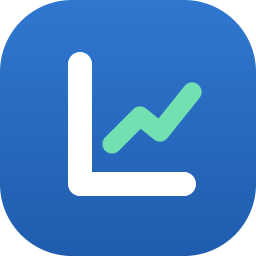

<p align="center"></p>

# Ledgerly

A private budget and accounting app in English and Arabic (right-to-left). Track income, spending and
savings, plan with ready-made budgets worked out from your own numbers, and see daily, weekly,
monthly and yearly statistics.

## Run it

**Windows, first time:** double-click **`run-setup.bat`**. It checks the files, puts a Ledgerly icon on your
Desktop and in the Start menu, runs a quick self-check, and opens the app in its own window.
After that, open Ledgerly from the icon (right-click it and choose *Pin to taskbar* for one-click access).

* `Ledgerly.bat` opens the app straight away, with no setup.
* `run-setup.bat -NoLaunch` sets up without opening the app.
* `run-setup.bat -Uninstall` removes the icons. Your data is not touched.

Nothing needs installing: the app is plain HTML, CSS and JavaScript. Setup uses Microsoft Edge, Chrome or
Brave for the standalone window and falls back to your default browser. It also works on any system by
opening `index.html` directly.

Developer option: `node tools/serve.js` serves it at http://localhost:5173. Browsers keep data per address,
so data saved there is separate from the app window that the icon opens. Pick one way and stay with it.

Your data is stored in the browser you use (localStorage) and never leaves it. Use
**Settings → Download backup** regularly; clearing browser data erases everything.

## What it does

| Area | Highlights |
| --- | --- |
| Dashboard | Net worth, income, expenses, net saved, budget left; cash flow by Day / Week / Month / Year; spending donut; insights and a financial-health score; upcoming bills; goals; your average day / week / month / year |
| Transactions | Income, expense and transfer ledger; search; filters; day groups with totals; bulk edit; CSV export; bank-CSV import with preview and duplicate skipping; payee autofill; repeat as scheduled |
| Budget | Zero-based plan ("left to budget" must reach zero), Needs / Wants / Savings split, inline editing, carry-forward plans per month |
| Plans | Smart plan built from your habits plus 50/30/20, 60/20/20, 60/30/10, 50/20/30, 45/15/40, all converted into amounts from your income, with preview before applying |
| Statistics | Day, week, month, year or custom range; comparison with the previous period; drill-down chart; income statement; category and source breakdown; highlights |
| Goals | Progress, needed-per-month, pace and ETA, deposits and withdrawals as transfers |
| Accounts | Checking, cash, savings, investment, credit card, loan; balances, 6-month trend, statement reconciliation |
| Scheduled | Salary, rent, subscriptions; auto-post or confirm each time; 30-day outlook |
| Settings | Language, light / dark / auto theme, 36 currencies, number format, week start, savings target, categories, backup and restore |

## Accounting rules

* Money is stored as integer minor units (cents), never floats.
* Balance = opening balance + income − expenses ± transfers (entries dated today or earlier).
* A transfer is never income or expense. "Saved" means transfers into savings or investment accounts.
* Net worth = sum of all account balances; credit cards and loans carry negative balances.
* Budgets are per month. A month without its own plan inherits the most recent earlier one, so history is never rewritten.
* A month in progress is compared with the same point in the previous month, not with a finished month.
* Changing the currency changes display only. Amounts are not converted.

## Project layout

```
run-setup.bat         first-time setup: icon on Desktop and Start menu, self-check, launch
Ledgerly.bat          opens the app in its own window, no setup needed
scripts/              setup.ps1, launch.ps1, common.ps1 (the logic behind the two .bat files)
assets/               ledgerly.ico and ledgerly.png (drawn by tools/make-icon.js)
index.html            page shell and icon sprite
css/styles.css        design tokens (light/dark), layout, components, responsive rules
js/util.js            money, dates, escaping html`` template
js/i18n.js            t() translation layer and Arabic plural rules
js/lang-ar.js         Arabic dictionary (English text is the key)
js/store.js           state, persistence, settings
js/engine.js          read-only accounting selectors (balances, budgets, goals, statistics, plans, insights)
js/actions.js         validated mutations (return undo data), recurring posting, CSV import
js/seed.js            default categories and the sample-data year
js/charts.js, ui.js   charts and shared UI kit
js/views/*.js         one file per page, plus the transaction dialog
js/app.js             router, global events, boot
tools/                engine-test.js, check-i18n.js, serve.js
```

## Checks

```
node tools/engine-test.js     # money, dates, accounting identities, plans, statistics, Arabic plurals
node tools/check-i18n.js      # every string the app can show has an Arabic translation
```

## Adding a language

Copy `js/lang-ar.js` to `js/lang-xx.js`, translate the values, load it in `index.html`, and add the
language to the switcher in `js/views/settings.js` and `js/store.js`. `check-i18n.js` lists anything missing.

## License

MIT. See [LICENSE](LICENSE).
